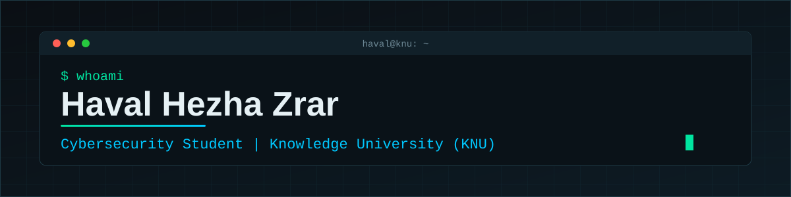

<svg xmlns="http://www.w3.org/2000/svg" viewBox="0 0 1200 300" width="1200" height="300" role="img" aria-labelledby="t d" xmlns:c2pa="http://c2pa.org/manifest"><metadata><c2pa:manifest>AAAWgmp1bWIAAAAeanVtZGMycGEAEQAQgAAAqgA4m3EDYzJwYQAAABZcanVtYgAAAEdqdW1kYzJtYQARABCAAACqADibcQN1cm46YzJwYTo0N2Q4NWUyMy03NmNhLTQ4MWItYmExNC0yMTM1MDc5NDIxZTAAAAADl2p1bWIAAAApanVtZGMyYXMAEQAQgAAAqgA4m3EDYzJwYS5hc3NlcnRpb25zAAAAALxqdW1iAAAARGp1bWRjYm9yABEAEIAAAKoAOJtxE2MycGEuaW5ncmVkaWVudC52MwAAAAAYYzJzaGG+3VO9DHWDInaaG03Af38AAABwY2JvcqNpZGM6Zm9ybWF0bWltYWdlL3N2Zyt4bWxqaW5zdGFuY2VJRHgseG1wOmlpZDpkY2VlNDhhMC0yYzY0LTQ4MmQtYWFmYy0wYWZmYjkyY2Y1NzBscmVsYXRpb25zaGlwaHBhcmVudE9mAAAB4mp1bWIAAABBanVtZGNib3IAEQAQgAAAqgA4m3ETYzJwYS5hY3Rpb25zLnYyAAAAABhjMnNoG5s5n+fPfup/OUT3HpRJMAAAAZljYm9yomdhY3Rpb25zgqJmYWN0aW9ua2MycGEub3BlbmVkanBhcmFtZXRlcnOha2luZ3JlZGllbnRzgaJjdXJseC1zZWxmI2p1bWJmPWMycGEuYXNzZXJ0aW9ucy9jMnBhLmluZ3JlZGllbnQudjNkaGFzaFggW9EOfh0nnqBLbuvDPGLoBN9hG1SUMPGVijow4Ii1XFWkZmFjdGlvbngdY29tLmFudGhyb3BpYy5jbGF1ZGUucHJvdmlkZWRqcGFyYW1ldGVyc6F4H2NvbS5hbnRocm9waWMub3JpZ2luLWNvbmZpZGVuY2VndW5rbm93bmtkZXNjcmlwdGlvbnhmQ2xhdWRlIHByb3ZpZGVkIHRoaXMgZmlsZSBhdCB0aGUgcmVxdWVzdCBvZiBhIHVzZXIgYW5kIG1heSBoYXZlIGNyZWF0ZWQgb3IgbW9kaWZpZWQgdGhlIGZpbGUgY29udGVudHMubXNvZnR3YXJlQWdlbnShZG5hbWVmQ2xhdWRlcmFsbEFjdGlvbnNJbmNsdWRlZPUAAADIanVtYgAAAEBqdW1kY2JvcgARABCAAACqADibcRNjMnBhLmhhc2guZGF0YQAAAAAYYzJzaGCIx1vNWGjivhHf2OOPfioAAACAY2JvcqVjYWxnZnNoYTI1NmNwYWRNAAAAAAAAAAAAAAAAAGRoYXNoWCBFP2N0CWm3k6cGR7xO5B9Nv5nv44EbBjcu0qfS7o896mRuYW1lbmp1bWJmIG1hbmlmZXN0amV4Y2x1c2lvbnOBomVzdGFydBi5Zmxlbmd0aBkeBAAAAj5qdW1iAAAAJ2p1bWRjMmNsABEAEIAAAKoAOJtxA2MycGEuY2xhaW0udjIAAAACD2Nib3KlY2FsZ2ZzaGEyNTZpc2lnbmF0dXJleE1zZWxmI2p1bWJmPS9jMnBhL3VybjpjMnBhOjQ3ZDg1ZTIzLTc2Y2EtNDgxYi1iYTE0LTIxMzUwNzk0MjFlMC9jMnBhLnNpZ25hdHVyZWppbnN0YW5jZUlEeCx4bXA6aWlkOmI2NzRhZTA5LTk3NDgtNGViZi1iZTRhLWI4NWQ3OTRmNGY0MnJjcmVhdGVkX2Fzc2VydGlvbnODomN1cmx4LXNlbGYjanVtYmY9YzJwYS5hc3NlcnRpb25zL2MycGEuaW5ncmVkaWVudC52M2RoYXNoWCBb0Q5+HSeeoEtu68M8YugE32EbVJQw8ZWKOjDgiLVcVaJjdXJseCpzZWxmI2p1bWJmPWMycGEuYXNzZXJ0aW9ucy9jMnBhLmFjdGlvbnMudjJkaGFzaFggYy7n7qcSu6yGJmTyqrq7vaPvyKZ2K1vBHpeahdmfsIeiY3VybHgpc2VsZiNqdW1iZj1jMnBhLmFzc2VydGlvbnMvYzJwYS5oYXNoLmRhdGFkaGFzaFggv3z1rsQUDaL/Uuj3v2E96fKNL/0F9NxoCxeNw4jFkZl0Y2xhaW1fZ2VuZXJhdG9yX2luZm+jZG5hbWVvQW50aHJvcGljIEZpbGVzZ3ZlcnNpb25lMS4wLjBrc3BlY1ZlcnNpb25lMi40LjAAABA4anVtYgAAAChqdW1kYzJjcwARABCAAACqADibcQNjMnBhLnNpZ25hdHVyZQAAABAIY2JvctKEWQISogEmGCFZAgowggIGMIIBjaADAgECAhRA5aAK7sI50L64g/oGQgU9Z1UTADAKBggqhkjOPQQDAzBJMRcwFQYDVQQKEw5BbnRocm9waWMsIFBCQzEuMCwGA1UEAxMlQW50aHJvcGljIENvbnRlbnQgQ3JlZGVudGlhbHMgUm9vdCBDQTAeFw0yNjA4MDcxODQzNTZaFw0yODA4MDYxOTQzNTZaMEQxFzAVBgNVBAoTDkFudGhyb3BpYywgUEJDMSkwJwYDVQQDEyBBbnRocm9waWMgQ2xhdWRlIENvbnRlbnQgU2lnbmluZzBZMBMGByqGSM49AgEGCCqGSM49AwEHA0IABJh6CmvLUBgFFNU0vUKlOVtE6djd17L5SuwX0LemFisBM3dkd/3cyjxFA3Qo5S46fX0/ihY0VZ7mfb9KF703t5OjWDBWMA4GA1UdDwEB/wQEAwIHgDAVBgNVHSUEDjAMBgorBgEEAYPoXgIBMAwGA1UdEwEB/wQCMAAwHwYDVR0jBBgwFoAUzlHiBIFOZFsj+OPEz5o+nMHXXMIwCgYIKoZIzj0EAwMDZwAwZAIwMXMdFJ4BetLLVY7ORuE9noqbbAZOZn/aArXyTwFAZfKrPzxF2vPoJNf1+UCdg1XGAjBwX1zd9WGqYkqmL5SFqw1QySjr1zJfpJM9+1rdDwSPLMOPOjKuiXjoU/pUUeG9RwmhY3BhZFkNngAAAAAAAAAAAAAAAAAAAAAAAAAAAAAAAAAAAAAAAAAAAAAAAAAAAAAAAAAAAAAAAAAAAAAAAAAAAAAAAAAAAAAAAAAAAAAAAAAAAAAAAAAAAAAAAAAAAAAAAAAAAAAAAAAAAAAAAAAAAAAAAAAAAAAAAAAAAAAAAAAAAAAAAAAAAAAAAAAAAAAAAAAAAAAAAAAAAAAAAAAAAAAAAAAAAAAAAAAAAAAAAAAAAAAAAAAAAAAAAAAAAAAAAAAAAAAAAAAAAAAAAAAAAAAAAAAAAAAAAAAAAAAAAAAAAAAAAAAAAAAAAAAAAAAAAAAAAAAAAAAAAAAAAAAAAAAAAAAAAAAAAAAAAAAAAAAAAAAAAAAAAAAAAAAAAAAAAAAAAAAAAAAAAAAAAAAAAAAAAAAAAAAAAAAAAAAAAAAAAAAAAAAAAAAAAAAAAAAAAAAAAAAAAAAAAAAAAAAAAAAAAAAAAAAAAAAAAAAAAAAAAAAAAAAAAAAAAAAAAAAAAAAAAAAAAAAAAAAAAAAAAAAAAAAAAAAAAAAAAAAAAAAAAAAAAAAAAAAAAAAAAAAAAAAAAAAAAAAAAAAAAAAAAAAAAAAAAAAAAAAAAAAAAAAAAAAAAAAAAAAAAAAAAAAAAAAAAAAAAAAAAAAAAAAAAAAAAAAAAAAAAAAAAAAAAAAAAAAAAAAAAAAAAAAAAAAAAAAAAAAAAAAAAAAAAAAAAAAAAAAAAAAAAAAAAAAAAAAAAAAAAAAAAAAAAAAAAAAAAAAAAAAAAAAAAAAAAAAAAAAAAAAAAAAAAAAAAAAAAAAAAAAAAAAAAAAAAAAAAAAAAAAAAAAAAAAAAAAAAAAAAAAAAAAAAAAAAAAAAAAAAAAAAAAAAAAAAAAAAAAAAAAAAAAAAAAAAAAAAAAAAAAAAAAAAAAAAAAAAAAAAAAAAAAAAAAAAAAAAAAAAAAAAAAAAAAAAAAAAAAAAAAAAAAAAAAAAAAAAAAAAAAAAAAAAAAAAAAAAAAAAAAAAAAAAAAAAAAAAAAAAAAAAAAAAAAAAAAAAAAAAAAAAAAAAAAAAAAAAAAAAAAAAAAAAAAAAAAAAAAAAAAAAAAAAAAAAAAAAAAAAAAAAAAAAAAAAAAAAAAAAAAAAAAAAAAAAAAAAAAAAAAAAAAAAAAAAAAAAAAAAAAAAAAAAAAAAAAAAAAAAAAAAAAAAAAAAAAAAAAAAAAAAAAAAAAAAAAAAAAAAAAAAAAAAAAAAAAAAAAAAAAAAAAAAAAAAAAAAAAAAAAAAAAAAAAAAAAAAAAAAAAAAAAAAAAAAAAAAAAAAAAAAAAAAAAAAAAAAAAAAAAAAAAAAAAAAAAAAAAAAAAAAAAAAAAAAAAAAAAAAAAAAAAAAAAAAAAAAAAAAAAAAAAAAAAAAAAAAAAAAAAAAAAAAAAAAAAAAAAAAAAAAAAAAAAAAAAAAAAAAAAAAAAAAAAAAAAAAAAAAAAAAAAAAAAAAAAAAAAAAAAAAAAAAAAAAAAAAAAAAAAAAAAAAAAAAAAAAAAAAAAAAAAAAAAAAAAAAAAAAAAAAAAAAAAAAAAAAAAAAAAAAAAAAAAAAAAAAAAAAAAAAAAAAAAAAAAAAAAAAAAAAAAAAAAAAAAAAAAAAAAAAAAAAAAAAAAAAAAAAAAAAAAAAAAAAAAAAAAAAAAAAAAAAAAAAAAAAAAAAAAAAAAAAAAAAAAAAAAAAAAAAAAAAAAAAAAAAAAAAAAAAAAAAAAAAAAAAAAAAAAAAAAAAAAAAAAAAAAAAAAAAAAAAAAAAAAAAAAAAAAAAAAAAAAAAAAAAAAAAAAAAAAAAAAAAAAAAAAAAAAAAAAAAAAAAAAAAAAAAAAAAAAAAAAAAAAAAAAAAAAAAAAAAAAAAAAAAAAAAAAAAAAAAAAAAAAAAAAAAAAAAAAAAAAAAAAAAAAAAAAAAAAAAAAAAAAAAAAAAAAAAAAAAAAAAAAAAAAAAAAAAAAAAAAAAAAAAAAAAAAAAAAAAAAAAAAAAAAAAAAAAAAAAAAAAAAAAAAAAAAAAAAAAAAAAAAAAAAAAAAAAAAAAAAAAAAAAAAAAAAAAAAAAAAAAAAAAAAAAAAAAAAAAAAAAAAAAAAAAAAAAAAAAAAAAAAAAAAAAAAAAAAAAAAAAAAAAAAAAAAAAAAAAAAAAAAAAAAAAAAAAAAAAAAAAAAAAAAAAAAAAAAAAAAAAAAAAAAAAAAAAAAAAAAAAAAAAAAAAAAAAAAAAAAAAAAAAAAAAAAAAAAAAAAAAAAAAAAAAAAAAAAAAAAAAAAAAAAAAAAAAAAAAAAAAAAAAAAAAAAAAAAAAAAAAAAAAAAAAAAAAAAAAAAAAAAAAAAAAAAAAAAAAAAAAAAAAAAAAAAAAAAAAAAAAAAAAAAAAAAAAAAAAAAAAAAAAAAAAAAAAAAAAAAAAAAAAAAAAAAAAAAAAAAAAAAAAAAAAAAAAAAAAAAAAAAAAAAAAAAAAAAAAAAAAAAAAAAAAAAAAAAAAAAAAAAAAAAAAAAAAAAAAAAAAAAAAAAAAAAAAAAAAAAAAAAAAAAAAAAAAAAAAAAAAAAAAAAAAAAAAAAAAAAAAAAAAAAAAAAAAAAAAAAAAAAAAAAAAAAAAAAAAAAAAAAAAAAAAAAAAAAAAAAAAAAAAAAAAAAAAAAAAAAAAAAAAAAAAAAAAAAAAAAAAAAAAAAAAAAAAAAAAAAAAAAAAAAAAAAAAAAAAAAAAAAAAAAAAAAAAAAAAAAAAAAAAAAAAAAAAAAAAAAAAAAAAAAAAAAAAAAAAAAAAAAAAAAAAAAAAAAAAAAAAAAAAAAAAAAAAAAAAAAAAAAAAAAAAAAAAAAAAAAAAAAAAAAAAAAAAAAAAAAAAAAAAAAAAAAAAAAAAAAAAAAAAAAAAAAAAAAAAAAAAAAAAAAAAAAAAAAAAAAAAAAAAAAAAAAAAAAAAAAAAAAAAAAAAAAAAAAAAAAAAAAAAAAAAAAAAAAAAAAAAAAAAAAAAAAAAAAAAAAAAAAAAAAAAAAAAAAAAAAAAAAAAAAAAAAAAAAAAAAAAAAAAAAAAAAAAAAAAAAAAAAAAAAAAAAAAAAAAAAAAAAAAAAAAAAAAAAAAAAAAAAAAAAAAAAAAAAAAAAAAAAAAAAAAAAAAAAAAAAAAAAAAAAAAAAAAAAAAAAAAAAAAAAAAAAAAAAAAAAAAAAAAAAAAAAAAAAAAAAAAAAAAAAAAAAAAAAAAAAAAAAAAAAAAAAAAAAAAAAAAAAAAAAAAAAAAAAAAAAAAAAAAAAAAAAAAAAAAAAAAAAAAAAAAAAAAAAAAAAAAAAAAAAAAAAAAAAAAAAAAAAAAAAAAAAAAAAAAAAAAAAAAAAAAAAAAAAAAAAAAAAAAAAAAAAAAAAAAAAAAAAAAAAAAAAAAAAAAAAAAAAAAAAAAAAAAAAAAAAAAAAAAAAAAAAAAAAAAAAAAAAAAAAAAAAAAAAAAAAAAAAAAAAAAAAAAAAAAAAAAAAAAAAAAAAAAAAAAAAAAAAAAAAAAAAAAAAAAAAAAAAAAAAAAAAAAAAAAAAAAAAAAAAAAAAAAAAAAAAAAAAAAAAAAAAAAAAAAAAAAAAAAAAAAAAAAAAAAAAAAAAAAAAAAAAAAAAAAAAAAAAAAAAAAAAAAAAAAAAAAAAAAAAAAAAAAAAAAAAAAAAAAAAAAAAAAAAAAAAAAAAAAAAAAAAAAAAAAAAAAAAAAAAAAAAAAAAAAAAAAAAAAAAAAAAAAAAAAAAAAAAAAAAAAAAAAAAAAAAAAAAAAAAAAAAAAAAAAAAAAAAAAAAAAAAAAAAAAAAAAAAAAAAAAAAAAAAAAAAAAAAAAAAAAAAAAAAAAAAAAAAAAAAAAAAAAAAAAAAAAAAAAAAAAAAAAAAAAAAAAAAAAAAAAAAAAAAAAAAAAAAAAAAAAAAAAAAAAAAAAAAAAAAAAAAAAAAAAAAAAAAAAAAAAAAAAAAAAAAAAAAAAAAAAAAAAAAAAAAAAAAAAAAAAAAAAAAAAAAAAAAAAAAAAAAAAAAAAAAAAAAAAAAAAAAAAAAAAAAAAAAAAAAAAAAAAAAAAAAAAAAAAAAAAAAAAAAAAAAAAAAAAAAAAAAAAAAAAAAAAAAAAAAAAAAAAAAAAAAAAAAAAAAAAAAAAAAAAAAAAAAAAAAAAAAAAAAAAAAAAAAAAAAAAAAAAAAAAAAAAAAAAAAAAAAAAAAAAAAAAAAAAAAAAAAAAAAAAAAAAAAAAAAAAAAAAAAAAAAAAAAAAAAAAAAAAAAAAAAAAAAAAAAAAAAAAAAAAAAAAAAAAAAAAAAAAAAAAAAAAAAAAAAAAAAAAAAAAAAAAAAAAAAAAAAAAAAAAAAAAAAAAAAAAAAAAAAAAAAAAAAAAAAAAAAAAAAAAAAAAAAAAAAAAAAAAAAAAAAAAAAAAAAAAAAAAAAAAAAAAAAAAAAAAAAAAAAAAAAAAAAAAAAAAAAAAAAAAAAAAAAAAAAAAAAAAAAAAAAAAAAAAAAAAAAAAAAAAAAAAAAAAAAAAAAAAAAAAAAAAAAAAAAAAAAAAAAAAAAAAAAAAAAAAAAAAAAAAAAAAAAAAAAAAAAAAAAAAAAAAAAAAAAAAAAAAAAAAAAAAAAAAAAAAAAAAAAAAAAAAAAAAAAAAAAAAAAAAAAAAAAAAAAAAAAAAPZYQEjMdWdUBkzNbhwb7dghBolsyHn0SPH1SwrKosbS5NjZDsvw4+D/d+r8uRlvn/vmF6MLWw7P2J8t1yg9IxKoTR4=</c2pa:manifest></metadata>
  <title id="t">MrNaNo|N4N0 Staff - Cybersecurity Student</title>
  <desc id="d">Dark terminal-style animated banner with the name MrNaNo|N4N0 Staff, Cybersecurity Student at Knowledge University.</desc>
  <defs>
    <linearGradient id="bg" x1="0" y1="0" x2="1" y2="1">
      <stop offset="0" stop-color="#070a0f"/>
      <stop offset="1" stop-color="#0d1b24"/>
    </linearGradient>
    <linearGradient id="accent" x1="0" y1="0" x2="1" y2="0">
      <stop offset="0" stop-color="#00e5a0"/>
      <stop offset="0.5" stop-color="#00c8ff"/>
      <stop offset="1" stop-color="#00e5a0"/>
      <animate attributeName="x1" values="-1;0" dur="3s" repeatCount="indefinite"/>
      <animate attributeName="x2" values="0;1" dur="3s" repeatCount="indefinite"/>
    </linearGradient>
    <pattern id="grid" width="40" height="40" patternUnits="userSpaceOnUse">
      <path d="M40 0H0V40" fill="none" stroke="#14303a" stroke-width="1" opacity="0.55"/>
    </pattern>
    <pattern id="scan" width="4" height="4" patternUnits="userSpaceOnUse">
      <rect width="4" height="1" fill="#000" opacity="0.28"/>
    </pattern>
    <filter id="glow" x="-20%" y="-50%" width="140%" height="200%">
      <feGaussianBlur stdDeviation="4" result="b"/>
      <feMerge><feMergeNode in="b"/><feMergeNode in="SourceGraphic"/></feMerge>
    </filter>
    <radialGradient id="vig" cx="0.5" cy="0.5" r="0.75">
      <stop offset="0.6" stop-color="#000" stop-opacity="0"/>
      <stop offset="1" stop-color="#000" stop-opacity="0.55"/>
    </radialGradient>
    <clipPath id="win"><rect x="60" y="48" width="1080" height="204" rx="10"/></clipPath>
  </defs>

  <rect width="1200" height="300" fill="url(#bg)"/>
  <rect width="1200" height="300" fill="url(#grid)"/>
  <rect x="0.5" y="0.5" width="1199" height="299" fill="none" stroke="#1e3a45"/>

  <!-- terminal window -->
  <rect x="60" y="48" width="1080" height="204" rx="10" fill="#0a1218" stroke="#00c8ff" stroke-opacity="0.45" filter="url(#glow)"/>
  <path d="M60 58a10 10 0 0 1 10-10h1060a10 10 0 0 1 10 10v26H60z" fill="#112029"/>
  <circle cx="86" cy="66" r="6" fill="#ff5f56"/>
  <circle cx="108" cy="66" r="6" fill="#ffbd2e"/>
  <circle cx="130" cy="66" r="6" fill="#27c93f"/>
  <text x="600" y="71" text-anchor="middle" font-family="Consolas, 'Courier New', monospace" font-size="14" fill="#6c8794">root@n4n0: ~ [secure shell]</text>

  <!-- drifting binary, clipped to the window -->
  <g clip-path="url(#win)" font-family="Consolas, 'Courier New', monospace" font-size="14" fill="#00e5a0" opacity="0.16">
    <g><text x="760" y="100">1 0 1 1 0 0 1</text><text x="760" y="130">0 1 0 0 1 1 0</text><text x="760" y="160">1 1 0 1 0 1 1</text><text x="760" y="190">0 0 1 0 1 0 0</text><text x="760" y="220">1 0 1 1 0 1 0</text><text x="760" y="250">0 1 1 0 0 1 1</text>
      <animateTransform attributeName="transform" type="translate" values="0 0;0 -60" dur="6s" repeatCount="indefinite"/></g>
    <g><text x="910" y="100">N 4 N 0</text><text x="910" y="130">0 1 1 0 1</text><text x="910" y="160">1 0 0 1 0</text><text x="910" y="190">S T A F F</text><text x="910" y="220">0 1 0 1 1</text><text x="910" y="250">1 1 0 0 1</text>
      <animateTransform attributeName="transform" type="translate" values="0 -60;0 0" dur="8s" repeatCount="indefinite"/></g>
    <g><text x="1040" y="100">0 1 0 1</text><text x="1040" y="130">1 1 0 0</text><text x="1040" y="160">0 0 1 1</text><text x="1040" y="190">1 0 1 0</text><text x="1040" y="220">0 1 1 1</text><text x="1040" y="250">1 0 0 1</text>
      <animateTransform attributeName="transform" type="translate" values="0 0;0 -60" dur="5s" repeatCount="indefinite"/></g>
  </g>

  <!-- content -->
  <text x="92" y="122" font-family="Consolas, 'Courier New', monospace" font-size="20" fill="#00e5a0">$ whoami</text>

  <!-- glitch layers -->
  <text x="92" y="176" font-family="'Segoe UI', Arial, Helvetica, sans-serif" font-size="52" font-weight="700" fill="#ff2d95" opacity="0">MrNaNo|N4N0 Staff
    <animate attributeName="opacity" values="0;0;0.75;0;0;0.6;0" keyTimes="0;0.86;0.88;0.9;0.95;0.96;1" dur="4s" repeatCount="indefinite"/>
    <animate attributeName="x" values="92;92;86;92;92;97;92" keyTimes="0;0.86;0.88;0.9;0.95;0.96;1" dur="4s" repeatCount="indefinite"/>
  </text>
  <text x="92" y="176" font-family="'Segoe UI', Arial, Helvetica, sans-serif" font-size="52" font-weight="700" fill="#00c8ff" opacity="0">MrNaNo|N4N0 Staff
    <animate attributeName="opacity" values="0;0;0.75;0;0;0.6;0" keyTimes="0;0.86;0.88;0.9;0.95;0.96;1" dur="4s" repeatCount="indefinite"/>
    <animate attributeName="x" values="92;92;98;92;92;87;92" keyTimes="0;0.86;0.88;0.9;0.95;0.96;1" dur="4s" repeatCount="indefinite"/>
  </text>

  <!-- main name -->
  <text x="92" y="176" font-family="'Segoe UI', Arial, Helvetica, sans-serif" font-size="52" font-weight="700" fill="#e6f1f5" filter="url(#glow)"><tspan>MrNaNo</tspan><tspan fill="#00e5a0">|</tspan><tspan fill="#00c8ff">N4N0</tspan><tspan fill="#e6f1f5"> Staff</tspan></text>

  <rect x="92" y="190" width="340" height="3" rx="1.5" fill="url(#accent)">
    <animate attributeName="width" values="40;340;340;40" keyTimes="0;0.4;0.85;1" dur="5s" repeatCount="indefinite"/>
  </rect>
  <text x="92" y="226" font-family="Consolas, 'Courier New', monospace" font-size="22" fill="#00c8ff">&gt; Cybersecurity Student  |  Knowledge University (KNU)</text>

  <!-- blinking cursor -->
  <rect x="1040" y="205" width="12" height="24" fill="#00e5a0" filter="url(#glow)">
    <animate attributeName="opacity" values="1;1;0;0" keyTimes="0;0.5;0.5;1" dur="1s" repeatCount="indefinite"/>
  </rect>

  <!-- scanlines + vignette overlay -->
  <rect width="1200" height="300" fill="url(#scan)"/>
  <rect width="1200" height="300" fill="url(#vig)"/>
  <rect x="0" y="0" width="1200" height="3" fill="#00e5a0" opacity="0.12">
    <animate attributeName="y" values="-10;300" dur="4s" repeatCount="indefinite"/>
  </rect>
</svg>

 

### Cybersecurity Student · Knowledge University (KNU) · Kurdistan Region, Iraq

*Learning how systems break, so I can learn how to secure them.*

 

---

## `> about_me`

I'm a first-year Cybersecurity student at **Knowledge University** in the Kurdistan Region of Iraq. I'm interested in understanding how systems, networks, and applications actually work, and how to protect them.

I learn through university coursework, hands-on labs, small practical projects, and ethical security research. I'm at the beginning of this path, and this profile documents the journey honestly, from first scripts to more serious security work.

**Interests:** Cybersecurity · Ethical Hacking · Network Security · Python · C++ · Linux · Digital Forensics · Information Security

---

## `> learning_journey`

> Everything below is **in progress**. I'm building foundations, not claiming advanced expertise.

| Area | Focus | Stage |
| :-- | :-- | :-- |
| Cybersecurity fundamentals | Core concepts, threats, and the CIA triad | Learning |
| Computer networks | How data moves, common protocols, and network basics | Learning |
| Linux and command line | Navigating, scripting, and everyday tools | Learning |
| Python | Writing scripts and small tools | Practising |
| C++ | Syntax, memory, and problem solving | Learning |
| Web security fundamentals | How web apps work and common weaknesses | Beginner |
| Ethical hacking fundamentals | Methodology, legal and ethical boundaries | Beginner |

---

## `> technical_skills`

<table>
  <tr>
    <td width="50%" valign="top">

**Programming**

</td>
    <td width="50%" valign="top">

**Operating Systems**

</td>
  </tr>
  <tr>
    <td valign="top">

**Tools and Technologies**

</td>
    <td valign="top">

**Cybersecurity (fundamentals)**

</td>
  </tr>
</table>

---

## `> featured_projects`

Projects will appear here as I complete them. Nothing below is finished yet.

| Project | Description | Status | Repository |
| :-- | :-- | :-- | :-- |
| **Python Security Tools** | Small scripts that help me learn security concepts | 🔲 Planned | *Coming soon* |
| **C++ Programming Projects** | Exercises and small programs from my C++ studies | 🔲 Planned | *Coming soon* |
| **Network Security Labs** | Notes and write-ups from lab work | 🔲 Planned | *Coming soon* |
| **Web Security Research** | Ethical research on web security fundamentals | 🔲 Planned | *Coming soon* |
| **Linux Administration Projects** | Setup, scripting, and configuration practice | 🔲 Planned | *Coming soon* |

<!-- To activate a project, change the last cell to a link, e.g.
[View repository](https://github.com/NaNoDev101/REPO-NAME)
and update the Status to "In progress" or "Completed". -->

---

## `> github_stats`

> These cards come from third-party services. If one doesn't load, it's the service, not the profile. My live activity is always on my [GitHub profile](https://github.com/NaNoDev101).

---

## `> currently_working_on`

- Improving my **Python** programming
- Learning **C++**
- Developing cybersecurity projects
- Understanding **networking** and **system security**
- Building a professional **GitHub portfolio**

---

## `> university`

**[Knowledge University (KNU)](https://knu.edu.iq/)** · Department of Cybersecurity · Kurdistan Region, Iraq

---

*Security isn't a product you finish. It's a habit you build, one lab at a time.*

